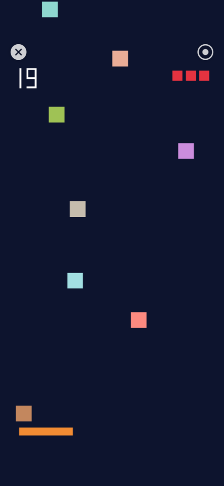

# henge

[](https://github.com/qusamulab/henge/actions/workflows/ci.yml)


An experimental project to run the native code of Android apps (APKs) on an iPhone alone.
No JIT, no debugger, no jailbreak: henge **converts the APK's `.so` files to Mach-O, signs them with your own certificate, and loads them** with a small linker.

> **Research project.** For learning and experimentation only. Do not use it for piracy, DRM circumvention, or distributing other people's apps. See [Disclaimer](#disclaimer).

## Approach

- **Ahead-of-time conversion (AOT)**: Android and iPhone are both ARM64, so machine code is not translated. Repacking the ELF as Mach-O and signing it is enough to run it as signed native code.
- **On-device**: Conversion, signing, and loading all happen inside a host app on the iPhone. Users do not need a Mac (development requires Xcode).
- **Container model**: Like LiveContainer, the host app `dlopen`s the converted dylibs. No per-app reinstall is needed.
- **Narrow scope**: Start with native games that do not use Java (NativeActivity / SDL2 / Godot, etc.). ART (Java/Kotlin) support comes later.

## Status

Milestone **M1** (call a function in a converted `.so`) works on macOS, the iOS Simulator and a real iPhone. M2 is in progress: a `native_app_glue` NativeActivity APK is converted, signed with your own identity and run (`android_main`) entirely on an iPhone. It draws with OpenGL ES, reads touch input and assets, and plays sound. See [docs/roadmap.md](docs/roadmap.md).

| | macOS | iOS Simulator | iPhone |
| --- | --- | --- | --- |
| ELF → Mach-O conversion (`henge-convert`) | ✅ | ✅ | — |
| `dlopen` + mini linker (`henge_link`) | ✅ | ✅ | ✅ |
| Calls, globals via GOT, function-pointer tables, `init_array` | ✅ | ✅ | ✅ |
| bionic shim: pthread objects, errno, fd I/O, liblog, ALooper, AConfiguration | ✅ | — | ✅ |
| NativeActivity host (`android_main` lifecycle, touch input, `assets/`, stub JNI) | ✅ | — | ✅ |
| OpenGL ES drawing (EGL on EAGL, GLES passed through to iOS), AAudio sound | — | — | ✅ |
| APK → `.so` → Mach-O → signature with your identity → run, inside the app (`Convert & Run`) | — | — | ✅ |

The host app reads an APK, extracts `lib/arm64-v8a/*.so`, converts it to Mach-O, **signs it on the device** and loads it. iOS only loads a library from the app container if it is signed by the same developer team as the app, so import your own identity once: export your Apple Development certificate and private key from Keychain Access as a `.p12`, open the app's **Signing** tab and import it (the `.p12` and its password stay in the device's Keychain; nothing leaves the phone). Without an identity the library gets an ad hoc signature, which iOS rejects (`code signature invalid`). `henge-convert --sign-identity NAME` and `--p12 FILE` (password in `$HENGE_P12_PASSWORD`) do the same on the Mac.

A NativeActivity APK opens full screen after **Convert & Run**: EGL is implemented on EAGL (the app's window is a `CAEAGLLayer`), GLES calls go straight to iOS's OpenGL ES, touches arrive as Android motion events, `AAssetManager` reads the APK's `assets/`, and AAudio plays through an AudioUnit. Tap ✕ to close it; the ● button records the screen with ReplayKit.

<p></p>

`samples/libgame` is a small C game (NativeActivity + OpenGL ES 2 + touch + AAudio + `assets/game.cfg`): drag to move the paddle and catch the squares; it plays itself after 5 idle seconds. `make samples-apk` builds `build/samples/game.apk`. Java / Kotlin code (dex) is not supported: that needs ART (M5). JNI is a stub, so games that depend on Java objects do not run.

**Security notes.** Signing keys are your own, never part of this repository (`.gitignore` covers `*.p12` and `*.mobileprovision`; `app/Local.xcconfig` holds your team ID). The imported `.p12` and its password are stored in the device's Keychain (this device only, after first unlock), so anyone who can unlock the phone and run henge can sign with that identity; remove it from the Signing tab when you no longer need it, and delete the `.p12` you exported. henge signs the native code of whatever APK you run with your developer certificate, and that code runs with the app's full privileges inside the iOS sandbox, so only run APKs you trust. The app's `Documents` folder is visible in the Files app (used to import the `.p12`).

Run a library from the terminal without tapping (the APK must be in the app's `Application Support/henge/apks/`):

```sh
xcrun devicectl device process launch --device <UDID> --console <bundle id> -- -convertRun native.apk
```

<p>
  
  
  
  
</p>

The host app has a **Library** for imported APKs (conversion comes in M2) and a **Diagnostics** screen that runs the M1 self-test and shows whether a debugger is attached.

## Building

Requirements: macOS on Apple Silicon, Xcode, Android NDK r27+ (`NDK_ROOT`, defaults to `/opt/homebrew/share/android-ndk`), Android SDK build-tools + a platform `android.jar` for the sample APK (`ANDROID_HOME`, defaults to `~/android-sdk`), XcodeGen.

```sh
make help      # list targets and variables
make test      # convert libadd.so and run it on macOS
make app       # xcodegen + build the host app for the iOS Simulator (SIM="iPhone 17")
make app-run   # boot SIM, install, launch; fails unless the app logs "PASS: m1 (0 failures)"
```

The simulator build is signed ad hoc and needs no Apple account. To run on an iPhone, set up your own signing:

```sh
cp app/Local.xcconfig.example app/Local.xcconfig   # your DEVELOPMENT_TEAM and bundle ID prefix
cd app && xcodegen && open henge.xcodeproj
```

Each developer signs with their own Apple ID and certificate. `app/Local.xcconfig` is gitignored; never commit team IDs, certificates, or provisioning profiles.

CI ([.github/workflows/ci.yml](.github/workflows/ci.yml)) runs `make test` and builds the host app for the simulator on every pull request.

## Repository layout

| Path | Contents |
| --- | --- |
| `include/henge/` | Public headers: `henge.h` (converter/runtime contract), `elf64.h` (ELF64 definitions) |
| `convert/` | ELF → Mach-O converter library (C, no dependencies): ELF validation, instruction scan, Mach-O writer, manifest, ad-hoc signer |
| `convert/main.c` | `henge-convert` CLI (not part of the library) |
| `apk/` | APK reader library (ZIP + binary `AndroidManifest.xml`, zlib only); `apk/main.c` is the `henge-apk` CLI |
| `runtime/` | Mini linker (image discovery, relocations, symbol lookup) and bionic shim |
| `app/` | iOS host app (SwiftUI), generated by XcodeGen from `project.yml` |
| `app/HengeHost/` | `App/` (entry, tabs), `Features/{Library,Diagnostics,Signing}/`, `Core/` (convert + run, M1 runner, signing store, bridging header), `Platform/` (EGL on EAGL, AAudio on AudioUnit), `Shared/` |
| `vm/` | henge-vm: Dalvik bytecode interpreter (C); `vm/core/` and `vm/android/` are the `java.*` / `android.*` classes it provides (prebuilt `.dex`, rebuilt by their `build.sh`); `vm/tests/` Java / Kotlin test code |
| `samples/` | Test `.so` sources built with the NDK (`lib*/`), sample APK manifests (`apk*/`), `kcatch/` Kotlin sample game for henge-vm |
| `tests/` | Converter layout test, macOS end-to-end test, APK reader test |
| `scripts/` | Xcode pre-build phase, simulator runner used by `make app-run`, dex embedding, shared JDK / SDK setup for the dex build scripts |
| `docs/` | Design docs and images |
| `research/` | Background research |

## Documents

| Path | Contents |
| --- | --- |
| [docs/architecture.md](docs/architecture.md) | Overall design, components, runtime flow |
| [docs/m1-elf-to-macho.md](docs/m1-elf-to-macho.md) | M1: ELF → Mach-O conversion and the mini linker |
| [docs/m2-patching.md](docs/m2-patching.md) | M2: instruction patching (`svc`, `tpidr_el0`, TLS) |
| [docs/roadmap.md](docs/roadmap.md) | Milestones, exit criteria, items to verify, current status |
| [research/abi-differences.md](research/abi-differences.md) | Android (AAPCS64 / bionic) vs Darwin arm64 differences and how to handle them |
| [research/prior-art.md](research/prior-art.md) | Prior projects and how henge differs |

## Disclaimer

henge is a **research project**. It exists to study how far Android native code can run on iOS within Apple's code-signing rules, and the docs and code are published for learning and discussion.

- **Use only software you have the right to run**: `.so` files you built yourself, or open-source / freely licensed APKs.
- **Do not use henge for piracy or abuse.** Do not distribute converted apps, bypass DRM, license checks, anti-cheat, or in-app purchases, or use it to violate any app's terms or anyone's rights.
- **Follow the rules that apply to you**: the licenses of the apps you run, Apple's and Google's terms, and the laws of your country. You are responsible for how you use henge.
- henge is **not affiliated with or endorsed by** Apple or Google. Android is a trademark of Google LLC; iPhone and iOS are trademarks of Apple Inc.
- henge is experimental and provided **as is, without warranty of any kind**. It may crash, lose data, or stop working with any iOS update.

If you find henge being used for abuse, or believe something here infringes your rights, please open an issue.

## Credits

- The Android robot in [docs/images/hero.png](docs/images/hero.png) is reproduced or modified from work created and shared by Google and used according to terms described in the [Creative Commons 3.0 Attribution License](https://creativecommons.org/licenses/by/3.0/).
