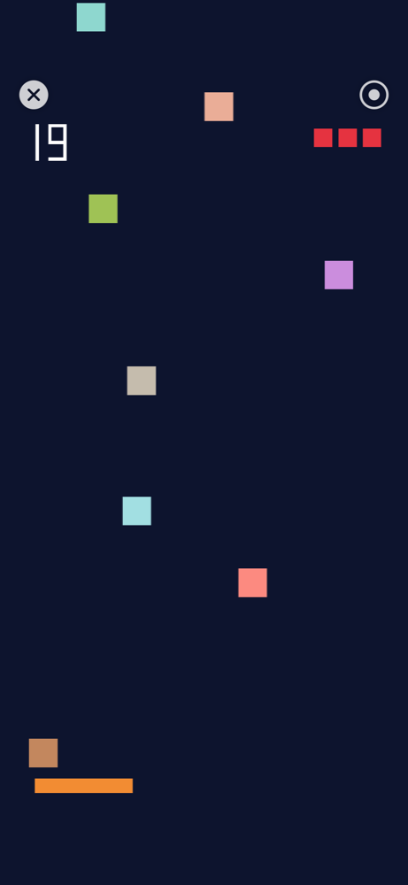

# henge

[](https://github.com/qusamulab/henge/actions/workflows/ci.yml)


An experimental project to run the native code of Android apps (APKs) on an iPhone alone.
No JIT, no debugger, no jailbreak: henge **converts the APK's `.so` files to Mach-O, signs them with your own certificate, and loads them** with a small linker.

> **Research project.** For learning and experimentation only. Do not use it for piracy, DRM circumvention, or distributing other people's apps. See [Disclaimer](#disclaimer).

## Approach

- **Ahead-of-time conversion (AOT)**: Android and iPhone are both ARM64, so machine code is not translated. Repacking the ELF as Mach-O and signing it is enough to run it as signed native code.
- **On-device**: Conversion, signing, and loading all happen inside a host app on the iPhone. Users do not need a Mac (development requires Xcode).
- **Container model**: Like LiveContainer, the host app `dlopen`s the converted dylibs. No per-app reinstall is needed.
- **Narrow scope**: Games whose heavy code is native. Pure NativeActivity apps run today; engines that start in a Java `Activity` (SDL2, Godot, ...) need their Java glue run by `henge-vm`, henge's own Dalvik interpreter, joined to the native code by JNI. The bridge and Java launcher host route are implemented; Android framework coverage and third-party engine compatibility are still limited.

## Status

Milestones **M1** to **M3** work for the samples: a `native_app_glue` NativeActivity APK (C or C++) is converted, signed with your own identity and run (`android_main`) entirely on an iPhone. It draws with OpenGL ES, reads touch input and assets, and plays sound. No third-party game runs yet: that needs a wider Android framework/shim surface and device validation described in [docs/roadmap.md](docs/roadmap.md).

| | macOS | iOS Simulator | iPhone |
| --- | --- | --- | --- |
| ELF → Mach-O conversion (`henge-convert`) | ✅ | ✅ | — |
| `dlopen` + mini linker (`henge_link`) | ✅ | ✅ | ✅ |
| Calls, globals via GOT, function-pointer tables, `init_array` | ✅ | ✅ | ✅ |
| bionic shim: pthread objects, errno, fd I/O, liblog, ALooper, AConfiguration | ✅ | — | ✅ |
| NativeActivity host (`android_main` lifecycle, touch input, `assets/`, stub JNI) | ✅ | — | ✅ |
| OpenGL ES drawing (EGL on EAGL, generated GLES ABI wrappers), AAudio sound | — | — | ✅ |
| APK → `.so` → Mach-O → signature with your identity → run, inside the app (`Convert & Run`) | — | — | ✅ |

The host app reads an APK, extracts `lib/arm64-v8a/*.so`, converts it to Mach-O, **signs it on the device** and loads it. iOS only loads a library from the app container if it is signed by the same developer team as the app, so import your own identity once: export your Apple Development certificate and private key from Keychain Access as a `.p12`, open the app's **Signing** tab and import it (the `.p12` and its password stay in the device's Keychain; nothing leaves the phone). Without an identity the library gets an ad hoc signature, which iOS rejects (`code signature invalid`). `henge-convert --sign-identity NAME` and `--p12 FILE` (password in `$HENGE_P12_PASSWORD`) do the same on the Mac.

A NativeActivity APK opens full screen after **Convert & Run**: EGL is implemented on EAGL (the app's window is a `CAEAGLLayer`), GLES calls use generated Android/Darwin ABI wrappers to iOS's OpenGL ES, touches arrive as Android motion events, `AAssetManager` reads the APK's `assets/`, and AAudio plays through an AudioUnit. Tap ✕ to close it; the ● button records the screen with ReplayKit.

<p></p>

`samples/libgame` is a small C game (NativeActivity + OpenGL ES 2 + touch + AAudio + `assets/game.cfg`): drag to move the paddle and catch the squares; it plays itself after 5 idle seconds. `make samples-apk` builds `build/samples/game.apk`. The iOS app supports both NativeActivity and Java launcher routes. `vm/` provides the Dalvik interpreter and JNI bridge; it is not ART or a complete Android framework. `make test-jni` tests native/Java round trips, GC roots and native thread callbacks. `make test-vm-jni-host` launches a Java Activity APK through JNI and Stop on macOS. The new iOS route builds for the simulator; it has not yet been executed on an iPhone.

**Security notes.** Signing keys are your own, never part of this repository (`.gitignore` covers `*.p12` and `*.mobileprovision`; `app/Local.xcconfig` holds your team ID). The imported `.p12` and its password are stored in the device's Keychain (this device only, after first unlock), so anyone who can unlock the phone and run henge can sign with that identity; remove it from the Signing tab when you no longer need it, and delete the `.p12` you exported. henge signs the native code of whatever APK you run with your developer certificate, and that code runs with the app's full privileges inside the iOS sandbox, so only run APKs you trust. The app's `Documents` folder is visible in the Files app (used to import the `.p12`).

Platform probes for V1 / V2 / V6 (`TPIDR_EL0`, x18, memory budget) print with `-probe YES` at launch.

Run a library from the terminal without tapping (the APK must be in the app's `Application Support/henge/apks/`):

```sh
xcrun devicectl device process launch --device <UDID> --console <bundle id> -- -convertRun native.apk
```

<p>
  
  
  
  
</p>

The host app's **Library** supports filename search and sorting by import date, name or size (the selected order is remembered). Imports run in the background, validate the archive and binary manifest before adding it, and preserve existing files when names collide. A failed batch reports all failed files together while keeping successful imports.

Open an APK to inspect its package, version, SDK requirements, native architectures and ARM64 libraries before **Convert & Run**. Missing ARM64 libraries or a missing NativeActivity entry library are explained before execution; these checks do not guarantee runtime compatibility. Java/Kotlin launchers use henge-vm and JNI. The detail screen also lists unresolved native symbols and load blockers. Execution logs belong to the APK that produced them and can be shared from its detail screen. **Diagnostics** runs the M1 self-test and shows whether a debugger is attached.

The host allows **one guest per process**. After Stop, a load failure, or the native Diagnostics test, close henge from the app switcher and reopen it before the next run. Native code, JNI VM contexts and guest threads can remain alive until process exit; signing keys are not isolated from the guest.

Imports cache unsigned conversion by APK hash/converter/platform. Signed outputs have a separate certificate key and 24-hour reuse limit, with hashes checked on cache hits; saved app data is outside the cache. File-backed extraction, conversion and signing avoid whole-library heap copies. Android `dlopen` can also convert/sign an unconverted ELF on demand through a host hook; immediate and subsequent loads pass on macOS, while iPhone acceptance remains unverified.

The host persists signal crash records (image/registers and unsupported-function name), then displays/shares them after restart. This cannot capture SIGKILL or out-of-memory termination. Callable missing imports use signed abort stubs; unresolved data still blocks loading.

To inspect Java class-library gaps without executing an APK:

```sh
python3 scripts/check-dex.py path/to/app.apk          # exit 1 if references are missing
python3 scripts/check-dex.py --json path/to/app.apk   # classes, methods and fields
make test-generated                                # generated libc/GLES/JNI and scanner regressions
```

JNI reflection conversion, DefineClass, monitors and direct ByteBuffer operations are explicitly unsupported. Java Thread.start remains synchronous, and engine SurfaceView/service glue needs further work. Free Apple ID signing, automatic process relaunch/key isolation, ANGLE and third-party SDL2 execution are not validated or complete; see the detailed status in [the roadmap](docs/roadmap.md).

## Building

Requirements: macOS on Apple Silicon, Xcode, Android NDK r27+ (`NDK_ROOT`, defaults to `/opt/homebrew/share/android-ndk`), Android SDK build-tools + a platform `android.jar` for the sample APK (`ANDROID_HOME`, defaults to `~/android-sdk`), XcodeGen.

```sh
make help      # list targets and variables
make test      # run converter, runtime, APK and Java / Kotlin VM tests on macOS
make test-library # APK inspection, validated imports, batch errors, search and sorting
make app       # xcodegen + build the host app for the iOS Simulator (SIM="iPhone 17")
make app-run   # boot SIM, install, launch; fails unless the app logs "PASS: m1 (0 failures)"
```

The simulator build is signed ad hoc and needs no Apple account. To run on an iPhone, set up your own signing:

```sh
cp app/Local.xcconfig.example app/Local.xcconfig   # your DEVELOPMENT_TEAM and bundle ID prefix
cd app && xcodegen && open henge.xcodeproj
```

Each developer signs with their own Apple ID and certificate. `app/Local.xcconfig` is gitignored; never commit team IDs, certificates, or provisioning profiles.

CI ([.github/workflows/ci.yml](.github/workflows/ci.yml)) runs `make test` and builds the host app for the simulator on every pull request.

Build rules live in `mk/`: `config.mk` holds toolchain settings, `sources.mk` lists library sources,
and `libraries.mk`, `samples.mk`, `tests.mk`, and `app.mk` define their respective targets.
Compiler-generated dependencies rebuild only the C / assembly files affected by a header change.
Use a separate output directory when changing compiler flags, for example
`make B=build/debug CFLAGS='-O0 -g' test-vm test-vm-lifecycle`.
DEX rebuild scripts share the same `ANDROID_HOME` default as Make and stop on compiler failures.

## Repository layout

| Path | Contents |
| --- | --- |
| `include/henge/` | Public headers: `henge.h` (converter/runtime contract), `vm_host.h` (Java Activity host), `jni.h` (JNI ABI), `elf64.h` (ELF64 definitions) |
| `convert/` | ELF → Mach-O converter library (C, no dependencies): ELF validation, instruction scan, Mach-O writer, manifest, ad-hoc signer |
| `convert/main.c` | `henge-convert` CLI (not part of the library) |
| `apk/` | APK reader library: `apk.c` owns archive lifetime and indexed name lookup, `zip.c` parses / extracts ZIP entries, `axml.c` reads the manifest; `main.c` is the `henge-apk` CLI |
| `runtime/` | Mini linker (image discovery, relocations, symbol lookup) and bionic shim |
| `app/` | iOS host app (SwiftUI), generated by XcodeGen from `project.yml` |
| `app/HengeHost/` | `App/` (entry, tabs), `Features/{Library,Diagnostics,Signing}/`, `Core/` (convert + run, M1 runner, signing store, bridging header), `Platform/` (EGL on EAGL, AAudio on AudioUnit), `Shared/` |
| `vm/` | henge-vm: Dalvik bytecode interpreter (C); `heap.c` handles allocation / GC, `strings.c` handles encoding / interning. `core/` and `android/` provide the Java / Android classes (prebuilt `.dex`, rebuilt by their `build.sh`); `tests/` contains Java / Kotlin test code |
| `samples/` | Test `.so` sources built with the NDK (`lib*/`), sample APK manifests (`apk*/`), `kcatch/` Kotlin sample game for henge-vm |
| `tests/` | Converter / runtime integration, APK parsing / indexed lookup, VM execution / lifecycle tests |
| `mk/` | Build configuration, library sources, samples, tests and iOS app targets |
| `scripts/` | Reviewed libc/GLES/JNI generators, DEX reference scanner, Xcode pre-build phase, simulator runner used by `make app-run`, dex embedding, shared JDK / SDK setup for the dex build scripts |
| `docs/` | Design docs and images |
| `research/` | Background research |

## Documents

| Path | Contents |
| --- | --- |
| [docs/architecture.md](docs/architecture.md) | Overall design, components, runtime flow |
| [docs/m1-elf-to-macho.md](docs/m1-elf-to-macho.md) | M1: ELF → Mach-O conversion and the mini linker |
| [docs/m2-patching.md](docs/m2-patching.md) | M2: instruction patching (`svc`, `tpidr_el0`, TLS) |
| [docs/roadmap.md](docs/roadmap.md) | Milestones, exit criteria, items to verify, current status |
| [research/abi-differences.md](research/abi-differences.md) | Android (AAPCS64 / bionic) vs Darwin arm64 differences and how to handle them |
| [research/prior-art.md](research/prior-art.md) | Prior projects and how henge differs |

## Disclaimer

henge is a **research project**. It exists to study how far Android native code can run on iOS within Apple's code-signing rules, and the docs and code are published for learning and discussion.

- **Use only software you have the right to run**: `.so` files you built yourself, or open-source / freely licensed APKs.
- **Do not use henge for piracy or abuse.** Do not distribute converted apps, bypass DRM, license checks, anti-cheat, or in-app purchases, or use it to violate any app's terms or anyone's rights.
- **Follow the rules that apply to you**: the licenses of the apps you run, Apple's and Google's terms, and the laws of your country. You are responsible for how you use henge.
- henge is **not affiliated with or endorsed by** Apple or Google. Android is a trademark of Google LLC; iPhone and iOS are trademarks of Apple Inc.
- henge is experimental and provided **as is, without warranty of any kind**. It may crash, lose data, or stop working with any iOS update.

If you find henge being used for abuse, or believe something here infringes your rights, please open an issue.

## Credits

- The Android robot in [docs/images/hero.png](docs/images/hero.png) is reproduced or modified from work created and shared by Google and used according to terms described in the [Creative Commons 3.0 Attribution License](https://creativecommons.org/licenses/by/3.0/).
